<picture>
  <source media="(prefers-color-scheme: dark)" srcset="./assets/header-dark.svg">
  <source media="(prefers-color-scheme: light)" srcset="./assets/header-light.svg">
  
</picture>

<a href="https://shreesh-sree.dev"><code>[ portfolio ]</code></a> <a href="https://linkedin.com/in/sree-santh"><code>[ linkedin ]</code></a> <a href="https://x.com/shreesh_algoqx"><code>[ x ]</code></a> <a href="https://algoqx.tech"><code>[ algoqx ]</code></a> <a href="https://codolio.com/profile/shreesh-22"><code>[ codolio ]</code></a> <a href="mailto:shreesh.exe22@gmail.com"><code>[ mail ]</code></a>

<picture>
  <source media="(prefers-color-scheme: dark)" srcset="./assets/neofetch-dark.svg">
  <source media="(prefers-color-scheme: light)" srcset="./assets/neofetch-light.svg">
  
</picture>

<picture>
  <source media="(prefers-color-scheme: dark)" srcset="./assets/activity-dark.svg">
  <source media="(prefers-color-scheme: light)" srcset="./assets/activity-light.svg">
  
</picture>

<a href="https://github.com/Shreesh-Sree/Aethercode-main"><picture>
  <source media="(prefers-color-scheme: dark)" srcset="./assets/project-01-dark.svg">
  <source media="(prefers-color-scheme: light)" srcset="./assets/project-01-light.svg">
  
</picture></a>
<a href="https://github.com/Shreesh-Sree/AetherCode-Execution-Engine"><picture>
  <source media="(prefers-color-scheme: dark)" srcset="./assets/project-02-dark.svg">
  <source media="(prefers-color-scheme: light)" srcset="./assets/project-02-light.svg">
  
</picture></a>

<a href="https://github.com/ggml-org/llama.cpp/pull/29143"><picture>
  <source media="(prefers-color-scheme: dark)" srcset="./assets/project-03-dark.svg">
  <source media="(prefers-color-scheme: light)" srcset="./assets/project-03-light.svg">
   active subspace; lossless, upstream PR #29143" width="49%">
</picture></a>
<a href="https://github.com/Shreesh-Sree/LearnHouse-StJosephs"><picture>
  <source media="(prefers-color-scheme: dark)" srcset="./assets/project-04-dark.svg">
  <source media="(prefers-color-scheme: light)" srcset="./assets/project-04-light.svg">
  
</picture></a>

<picture>
  <source media="(prefers-color-scheme: dark)" srcset="./assets/career-dark.svg">
  <source media="(prefers-color-scheme: light)" srcset="./assets/career-light.svg">
  
</picture>

<picture>
  <source media="(prefers-color-scheme: dark)" srcset="./assets/prs-dark.svg">
  <source media="(prefers-color-scheme: light)" srcset="./assets/prs-light.svg">
  
</picture>

<!--UPSTREAM:START-->

<a href="https://github.com/ggml-org/llama.cpp/pull/29143"><code>ggml-org/llama.cpp#29143</code></a> &nbsp;·&nbsp; <a href="https://github.com/interviewstreet/hiring-agent/pull/340"><code>interviewstreet/hiring-agent#340</code></a> &nbsp;·&nbsp; <a href="https://github.com/golang/go/pull/81613"><code>golang/go#81613</code></a> &nbsp;·&nbsp; <a href="https://github.com/kubernetes-sigs/cluster-api/pull/14451"><code>kubernetes-sigs/cluster-api#14451</code></a> &nbsp;·&nbsp; <a href="https://github.com/apple/pkl-go/pull/285"><code>apple/pkl-go#285</code></a> &nbsp;·&nbsp; <a href="https://github.com/capitalone/datacompy/pull/598"><code>capitalone/datacompy#598</code></a> &nbsp;·&nbsp; <a href="https://github.com/moby/moby/pull/54105"><code>moby/moby#54105</code></a>

<!--UPSTREAM:END-->

<picture>
  <source media="(prefers-color-scheme: dark)" srcset="./assets/stack-dark.svg">
  <source media="(prefers-color-scheme: light)" srcset="./assets/stack-light.svg">
  
</picture>

<picture>
  <source media="(prefers-color-scheme: dark)" srcset="https://raw.githubusercontent.com/Shreesh-Sree/Shreesh-Sree/output/github-contribution-grid-snake-dark.svg">
  <source media="(prefers-color-scheme: light)" srcset="https://raw.githubusercontent.com/Shreesh-Sree/Shreesh-Sree/output/github-contribution-grid-snake.svg">
  
</picture>

<picture>
  <source media="(prefers-color-scheme: dark)" srcset="./assets/footer-dark.svg">
  <source media="(prefers-color-scheme: light)" srcset="./assets/footer-light.svg">
  
</picture>

<code>$ cat profile.txt</code> &nbsp;(plain text, for screen readers and search)

**Shreesh** · backend, distributed systems, LLM inference, security research · Chennai, India

**Projects**
- [aethercode](https://github.com/Shreesh-Sree/Aethercode-main): open-source coding assessment platform (go · grpc · postgres · casbin · k8s). runs exams for 10,000+ students; 11 go services, one schema each; casbin + 5s hmac caps + row-level sec; seb lockdown · vectorless rag; 172 commits · 22 ADRs
- [aethercode-engine](https://github.com/Shreesh-Sree/AetherCode-Execution-Engine): distributed code judge (go · redis streams · postgres · sse). fair queues · crash reclaim · DLQ; 60K+ submissions / month; 0 lost jobs @ 5k users / 15k subs; codeql · dependabot · coderabbit; next: self-healing SRE agent
- [fastmtp](https://github.com/ggml-org/llama.cpp/pull/29143): llama.cpp speculative decoding (c++ · cuda · ggml). qwen3.5 MTP draft-vocab trim; 152k vocab -> active subspace; lossless, upstream PR #29143
- [learnhouse-sjce](https://github.com/Shreesh-Sree/LearnHouse-StJosephs): open-source LMS fork, in prod (fastapi · next.js · postgres). 87 fork commits, synced upstream; multi-tenant superadmin console; seb · timed auto-submit · pools; erpnext roster + gradebook sync; 10,000+ students in production

**Experience**
- **HackerRank Campus Crew** · Apr 2026 -> · security researcher · technical lead · ambassador
  - 4-week authorized black-box test of the Desktop App
  - 2 criticals (CVSS 8.6, 9.6), demoed live to the CTO
  - VAPT report (OWASP/PTES/NIST), letter of recognition
- **AlgoQX · co-founder** · Jan 2026 -> · LM post-training and AI research
  - RLHF / RLVR, reward + verifier design, sandboxed envs
  - led 20 students shipping AetherCode, Engine, LearnHouse
- **Presidio · SDE intern** · Jun-Jul 2026 · 1 of 15 selected from 2,000+
  - expense platform for 3,000+ employees, FastAPI + 3 AI svcs
  - Azure Container Apps · Terraform · 4-role RBAC · OAuth
  - 150 pytest · 65 FE tests · Playwright · CodeQL · gitleaks
- **IIT Jammu · research intern** · Jun-Jul 2026 · agentic AI research
  - PINNs in PyTorch for SLS heat transfer, 12% accuracy gain
- **St. Joseph's College of Engineering** · -> 2028 · B.Tech AI & ML · Anna University · CGPA 8.23

**Stack**
- **lang**: Go · Python · C++ · TypeScript · JavaScript · SQL
- **backend**: FastAPI · gRPC · Gin · Node.js · Express · REST · SSE
- **ai-ml**: PyTorch · LangGraph · RAG · MCP · llama.cpp · CUDA
- **data**: PostgreSQL (RLS, pgvector) · Redis Streams · RabbitMQ
- **infra**: Docker · Kubernetes · Helm · Terraform · AWS · Azure
- **compute**: Slurm · NVIDIA MPS / MIG · Traefik · Cloudflare ZT
- **security**: Burp Suite · mitmproxy · OAuth · JWT · Casbin
- **ci**: GitHub Actions · Playwright · CodeQL · gitleaks
- **frontend**: React · Next.js

**Honors**
- Databricks Student Fellow, APJ: 1 of 38 from 7,171
- HackerRank Orchestrate: 3x bronze · best #116, top 6%
- Presidio PRIME SWE: 1 of 15 from 2,000+
- AWS Student Builder Group: campus leader
- HackerRank: problem solving · python · sql

<!--SYNC:START-->
last sync 2026-11-11 12:07 IST
<!--SYNC:END-->

